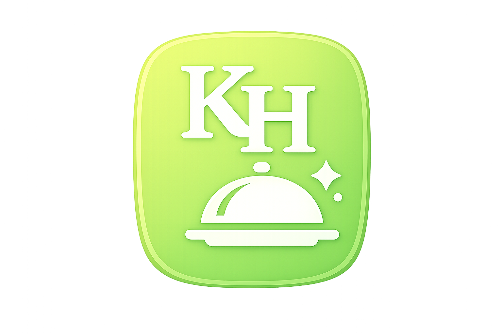

# Kazehana Cloud PMS - Sitio Web Oficial

[](https://github.com/Dvargas2332/Kazehana-Static-Website/actions/workflows/ci.yml)


Sitio web multi-pagina del sistema de gestion hotelera **Kazehana Cloud PMS**. Sitio estatico modular con partials compartidas (header/footer), CSS, JS y traducciones en archivos separados.

> **[Ver sitio en vivo ->](https://dvargas2332.github.io/Kazehana-Static-Website/)**

---

## Caracteristicas

- **Multi-pagina**: 7 paginas (Home, Modules, Workflow, FAQ, Contact, About, Pricing) con header y footer compartidos via build script
- **Multiidioma**: EN / ES / FR / PT / IT / JA con autodeteccion por navegador y persistencia en `localStorage`
- **Modo oscuro**: toggle manual con deteccion automatica de `prefers-color-scheme`; dark-first con light mode via `data-dark-mode="light"`
- **Secciones completas**: hero, trust bar (logos OTA), modulos, workflow, timeline, integraciones, FAQ, formulario de contacto, about, pricing tiers, tabla comparativa
- **Footer 5-columnas**: Platform, Solutions, Resources, Company + badges de seguridad (PCI DSS, GDPR, SSL) + newsletter
- **Animaciones al hacer scroll**: elementos con `data-reveal` se animan al entrar en viewport via `IntersectionObserver`
- **Formulario de contacto**: envio via API con proteccion antispam mediante Cloudflare Turnstile
- **Carrousel de capturas**: autoplay con controles manuales
- **Header colapsable**: con estado persistente entre sesiones
- **Service Worker**: cache offline de assets estaticos
- **SEO**: datos estructurados JSON-LD (schema.org) en cada pagina
- **CI automatizado**: suite de validacion ejecutada en cada push

---

## Stack

| Tecnologia | Uso |
|---|---|
| HTML5 | Estructura de las paginas |
| CSS3 | Estilos modulares (css/styles.css + css/dark-mode.css) |
| JavaScript | Modulos IIFE con namespace KZT |
| Python 3 | Build script (stitch.py) |
| Cloudflare Turnstile | Proteccion antispam del formulario |
| Service Worker | Cache offline |
| GitHub Actions | CI/CD automatizado |
| GitHub Pages | Hosting gratuito |

---

## Requisitos

- Python 3.6+ (para build)
- Node.js v18 o superior (solo para validacion)

---

## Desarrollo local

```bash
# Build y servidor
npm run build
npm start

# Solo build (genera los HTML)
python3 scripts/stitch.py
```

Abre `http://localhost:3000` en el navegador.

> Tambien puedes abrir cualquier `.html` directamente en el navegador sin necesidad de servidor. Todas las dependencias usan rutas relativas y los HTML generados se commitean al repositorio.

---

## Estructura

```text
Kazehana-Static-Website/
|-- index.html              # Home: Hero + Trust bar + Summary + Hotels + Testimonials + CTA
|-- modules.html            # 6 modulos + Features + Screenshots carousel
|-- workflow.html           # Workflow + Timeline + Vision + Integraciones
|-- faq.html                # 10 FAQ items + Support channels
|-- contact.html            # Contact form + Contact info + Map
|-- about.html              # Story + Values + Awards
|-- pricing.html            # 3 tiers + Comparison table + Add-ons
|-- partials/
|   |-- header.html         # Shared <head> + <header> template
|   `-- footer.html         # Shared <footer> + <scripts> template
|-- pages/
|   |-- index.content.html
|   |-- modules.content.html
|   |-- workflow.content.html
|   |-- faq.content.html
|   |-- contact.content.html
|   |-- about.content.html
|   `-- pricing.content.html
|-- css/
|   |-- styles.css          # Estilos principales
|   `-- dark-mode.css       # Light mode overrides
|-- js/
|   |-- i18n-data.js        # Traducciones en 6 idiomas (~1000+ claves)
|   |-- i18n.js             # Deteccion de idioma + applyTranslations
|   |-- carousel.js         # Carrousel de capturas
|   |-- header-toggle.js    # Header colapsable
|   |-- notice.js           # Modal de aviso
|   |-- form-handler.js     # Envio del formulario de contacto
|   |-- dark-mode.js        # Toggle de modo oscuro
|   |-- scroll-reveal.js    # Animaciones al hacer scroll
|   |-- smooth-scroll.js    # Navegacion suave cross-page
|   `-- main.js             # Punto de entrada: inicializa todos los modulos
|-- sw.js                   # Service Worker para cache offline (v2)
|-- server.js               # Servidor estatico local (sin dependencias)
|-- scripts/
|   |-- stitch.py           # Build script: partials + content → HTML
|   |-- update-i18n.py      # i18n expansion script
|   `-- validate.js         # Validaciones automaticas multi-pagina
|-- ico/                    # Iconos de modulos y logo de Kazehana
`-- .github/
    `-- workflows/
        `-- ci.yml           # Pipeline de integracion continua
```

---

## Build System

El sitio usa un build script en Python (`scripts/stitch.py`) que ensambla las paginas:

1. Lee `partials/header.html` (template con placeholders `{{TITLE}}`, `{{DESCRIPTION}}`, `{{ACTIVE_*}}`)
2. Inserta el contenido unico de `pages/*.content.html`
3. Agrega `partials/footer.html`
4. Escribe el HTML completo a la raiz del proyecto

Los HTML generados se commitean a git para mantener compatibilidad con `file://` y GitHub Pages.

---

## Iconos del PMS

| Front Desk | Restaurant | Management | Accounting | E-Invoice | Channel Manager |
|---|---|---|---|---|---|
|  |  |  |  |  |  |

---

## Validacion

```bash
npm test
```

Verifica automaticamente:

- Existencia de las 7 paginas y su estructura basica
- Navegacion entre paginas
- Contenido especifico de cada pagina (trust bar, modulos, timeline, FAQ, contacto, about, pricing)
- Archivos CSS y JS cargados en cada pagina
- Archivos JS sin errores de sintaxis
- Traducciones en todos los idiomas
- Iconos de modulos
- Service Worker y JSON-LD
- Build script

---

## Deploy

### GitHub Pages
1. Ve a **Settings -> Pages** en el repositorio.
2. Selecciona la rama `main` y la carpeta raiz `/`.
3. Guarda; GitHub publica la URL automaticamente.

### AWS S3
1. Crea el bucket y habilita **Static Website Hosting**.
2. Sube todo el contenido de la carpeta raiz.
3. Aplica una bucket policy de solo lectura (`s3:GetObject`).

---

## Autor

**Diego Alonso Vargas Almengor**

- GitHub: [@Dvargas2332](https://github.com/Dvargas2332)
- LinkedIn: [Diego Vargas](https://www.linkedin.com/in/diego-vargas-almengor-5ba024240/)
- Email: vargas.almengor@gmail.com

---

## Licencia - Propietaria

**© 2025-2026 Diego Alonso Vargas Almengor. Todos los derechos reservados.**

Codigo propietario. Se permite la revision para fines de evaluacion unicamente. Cualquier uso, modificacion, distribucion o explotacion comercial requiere acuerdo de licencia por escrito.

Ver [LICENSE.md](./LICENSE.md) y [NOTICE.md](./NOTICE.md) para los terminos y avisos complementarios.
